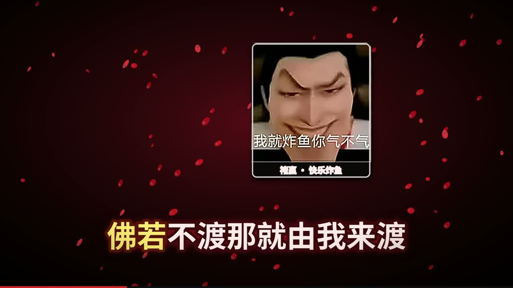
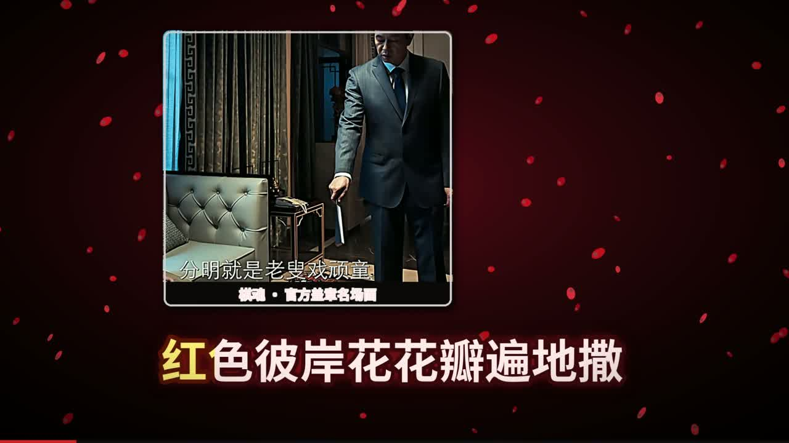
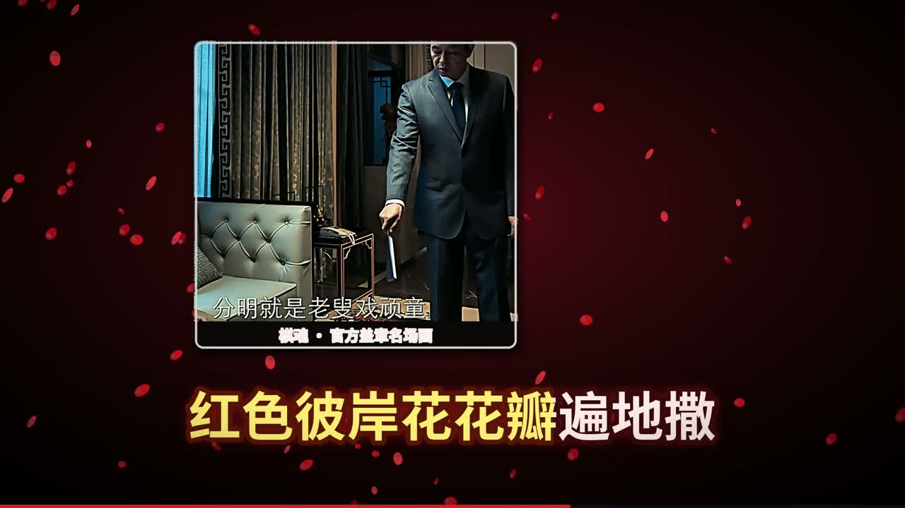
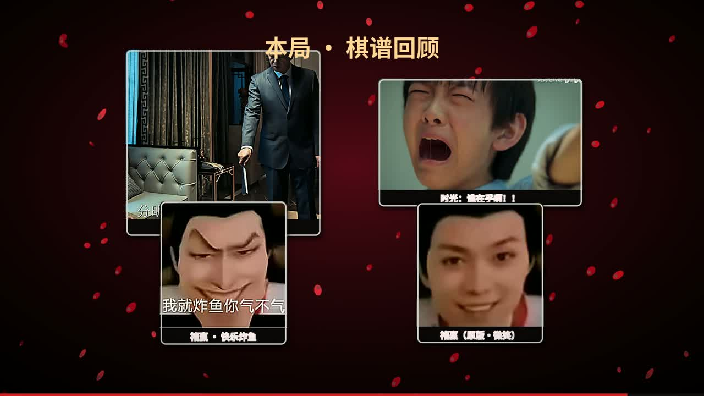

# 忘川彼岸 (DJ名龙版) · 棋魂梗图卡点 PV



一支用代码逐帧渲染的梗图卡点 PV，**非官方同人作品**：
把《棋魂》真人剧/动画的梗图——时光大哭、"老叟戏顽童"、褚嬴"我就炸鱼你气不气"、
（自制文字卡的）余亮"你走"——按 **123.05 BPM 的节拍网格** 切进《忘川彼岸 (DJ名龙版)》里。

这个仓库是这支片子的全部出片代码。你自备歌曲，三条命令就能从头渲染出来。

*English: the complete source of a code-rendered, unofficial fan PV that cuts Hikaru no Go
memes on the beat grid of the DJ remix of "忘川彼岸" (Wang Chuan Bi An). Bring your own copy
of the song and re-render everything with three commands. Code is MIT; the song and the
drama screenshots are not included (see NOTICE.md).*

## 成片

- **成片（1080p / 30fps / 3:00）**：见本仓库 [Releases](../../releases) —— 因体积与版权原因不入库，打包在 Release 附件里
- 成片截图在本仓库 `docs/` 下

| | |
|---|---|
|  |  |
|  |  |

## 快速开始

需要：Python 3.10+（`numpy` `scipy` `opencv-python` `Pillow`，见 `requirements.txt`）和 ffmpeg（在 PATH 里）。

```bash
# 0) 自备音频：把《忘川彼岸(DJ名龙版)》音频放到本目录，命名为 忘川彼岸DJ名龙.m4s
#    （获取方式见下文"音频"），然后转出两份分析/合成用音频：
ffmpeg -y -i 忘川彼岸DJ名龙.m4s assets/audio_full.m4a          # 合成用
ffmpeg -y -i 忘川彼岸DJ名龙.m4s -ac 1 -ar 22050 assets/audio_mono.wav   # 分析用

python analyze_beats.py     # 1) 频谱通量+自相关 → 节拍网格 (assets/grid.json)
python build_assets.py      # 2) LRC 解析/节拍吸附 → 图片卡片/文字层/歌词层/时间线
python render_pv.py         # 3) 逐帧渲染 1080p30 → 忘川彼岸DJ·棋魂梗图PV.mp4
```

- **耗时**：CPU 全片渲染约 6–10 分钟（5401 帧，纯 numpy/cv2 合成）。
- **只看关键帧**：`python render_pv.py preview 520,1560,3400` 会跳过编码，把指定帧存成 `assets/pv_frame_*.jpg`。
- **改分镜/换梗图**：素材全部在 `assets/` 下（`card_*.png` 卡片、`layer_*.png` 文字层、`timeline.json` 场景表），改完重跑 `build_assets.py` / `render_pv.py` 即可。

## 有节奏感是怎么实现的

- 音频先用 `analyze_beats.py` 做频谱通量 + 自相关测速，得到 **123.05 BPM、beat0=0.38s** 的节拍网格；
- LRC 每句歌词吸附到最近的节拍点（原始 LRC 是整秒取整的，吸附后与鼓点严格对齐）；
- 渲染时每一拍都有画面事件：镜头脉冲推近（力度按该拍低频鼓点能量加权）、边缘闪白、卡片呼吸缩放；
- 小节头（每 4 拍）追加震屏 + RGB 色散；副歌强度拉满，间奏做每小节一卡的梗图快切 montage。

## 分镜

| 时间 | 段落 | 内容 |
|---|---|---|
| 0:00–0:17 | 片头 | "忘川彼岸"行楷逐字砸落（每拍一字）+ 褚嬴"前方梗图高能预警" |
| 0:17–0:48 | 主歌 | 8 句歌词卡拉OK扫色，每句对应梗图砸入；"佛若不渡那就由我来渡"接炸鱼梗图收 punchline |
| 0:48–1:20 | DJ 间奏 | 梗图快切 montage：每小节一卡，砸落/旋转/滑入/震屏/RGB 分离轮换 |
| 1:20–1:50 | RAP | 16 句快嘴逐拍上屏，图片小卡左右交替切入 |
| 1:50–2:23 | 副歌 | 最高强度：震屏 + 色散 + 闪白 |
| 2:23–3:00 | 尾声 | "等到最后，她还是没有回头看" → 棋谱回顾拼贴 → 结束卡 |

## 音频（不入库，自备）

因版权原因，歌曲音频（`忘川彼岸DJ名龙.m4s` / `assets/audio_full.m4a` / `assets/audio_mono.wav`）
与渲染出的成片均**不在 git 仓库里**（见 `.gitignore`）。音频可从下列渠道获取：

- B 站：[忘川彼岸_零一九零贰-(dj名龙版)](https://www.bilibili.com/video/BV1wi5j69E2J)
- Apple Music：[忘川彼岸 (DJ名龙版) - 零一九零贰](https://music.apple.com/id/song/1667091297)
- Spotify：[忘川彼岸 - DJ名龙版](https://open.spotify.com/track/3UCLnZKDmStihsKq4SbeMc)

歌词来自 `w.lrc`（LRC 格式，已随仓库提供）。

## 目录结构

```
analyze_beats.py        # 节拍分析（频谱通量 + 自相关测速 + 相位拟合）
build_assets.py         # 素材构建：LRC→时间线、图片卡片化、"你走"文字梗卡、歌词层
render_pv.py            # 帧渲染器：所有动效锁节拍网格，rawvideo 管道给 ffmpeg
w.lrc                   # 歌词（00:17 起为演唱段）
屏幕截图 *.png / *.avif  # 梗图原图（时光大哭 / 老叟戏顽童 / 褚嬴原版 / 褚嬴炸鱼梗图）
assets/                 # 全部为生成物（.gitignore 已忽略），重跑脚本即可重建
docs/                   # README 用成片截图
```

## License

- 代码：[MIT](LICENSE)
- 歌曲《忘川彼岸》（词曲：浮生，原唱：零一九零贰，DJ 版：名龙）与《棋魂》剧集画面版权归原作者所有，本仓库与其 Releases 均不包含；梗图为粉丝二创用途。
